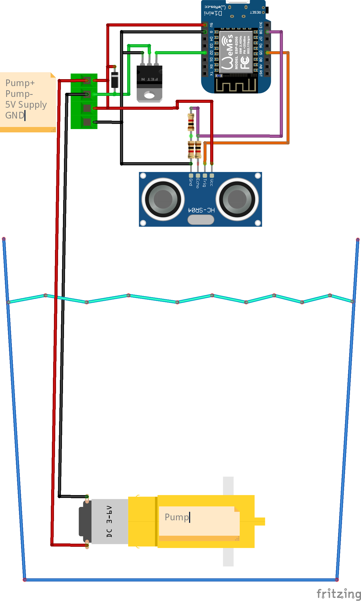

# pump-out control
My sanitary facility ha an overflow from the boiler. This ends up in the basement. To reduce the water evaporation because of the spilled water I accumulate the water in a bucket and added a water pump to pump it out.
The purpose of this project is to control the water pump and log the build-up of the water level and activation time of the pump.

For the logging and display on a localy hosted website I used my (simple-sensorlogger-esp32 project)[https://github.com/grafmar/simple-sensorlogger-esp32].

The water level is checked independently of the configurable logging interval. When the measured distance reaches the upper threshold, the pump starts. It keeps running until the distance reaches the lower threshold or has run for 20 minutes, whichever comes first. The pump runtime and water level are logged when pumping stops.

The recorded data can be accessed through the integrated Web UI, where it is displayed as interactive graphs directly served by the device.

## Overview
The device consists of an ESP8266 connected to a ultrasonic distance sensor HC-SR04. The output controlls a n-channel FET which switches the GND of the pump.

<p align="center"></p>

The webserver running on the ESP8266 serves the files directly from the filesystem (LittleFS). All the files like javascript html and images are ready to use on the filesystem and no active code has to be executed to show the webpage with the sensor data except for the sensor data themselves. Because they are stored in multiple files, a streaming agent concatenas all files and streams it as one big csv file.

On the other hand the sensor sampler handles the ultrasonic distance sensor every configured period and stores the data into the log chunkes on the LittleFS.

The webpage showing a chart of the sensordata with enabled pan and zoom. The data can be hidden/shown using the checkboxes on the top.

<p align="center"></p>


## Hardware
The hardware contains the following parts:
- Wemod D1 mini (ESP8266 module)
- HC-SR04 ultrasonic distance sensor
- n-channel FET (FDN359AN)
- 5V USB water pump
- 3x 1k resistors for voltage divider

The ESP8266 is connected to an outer 5V power supply. The HC-SR04 is also connected to 5V and therefore has 5V output logic levels. Bring the echo output from 5V down to the ESP8266's 3.3V input level using a voltage divider. The trigger input of the HC-SR04 works with the ESP8266's 3.3V output.
The firmware uses D5 for TRIG, D8 for ECHO, and D2 to control the pump FET. D8/GPIO15 is a boot-strap pin and must remain LOW while the ESP8266 starts. To drive the pump, an n-channel FET switches its GND. Because the pump is an inductive load, add a diode parallel to the pump.

<p align="center"></p>

## Software
The firmware uses the `HCSR04` library to measure the sensor distance every second. It averages the valid results from five readings; at least three readings must be within 5-50 cm for the batch to be valid. Water level is calculated as `31 cm - measured distance`. The pump starts at a water level of 21 cm (10 cm sensor distance) and stops at 3 cm (28 cm sensor distance). Three consecutive invalid measurement batches stop an active pump. A 20-minute maximum runtime also stops the pump if the low-level threshold is not reached.

The configurable logging interval controls periodic water-level records. A sample is stored as `timestamp;water_level_cm;`; after pumping stops, one row is stored as `timestamp;water_level_cm;pump_runtime_seconds`. There are no separate pump-start or event rows. Pump runtime is measured with the ESP8266 monotonic clock, while timestamps use NTP. Entries are not buffered: if NTP time is unavailable when an entry is written, it is discarded.

### Log File Handling
Sensor data is stored in rotating log files.
Each log file has a fixed maximum chunk size of 32 kB.

New sensor entries are appended to `log_0.csv`.
Once this file reaches the maximum chunk size, a log rotation is triggered:

- All existing log files are renamed with an incremented index
- The oldest log chunk (highest index) is deleted
- A new `log_0.csv` is created for continued logging

This mechanism ensures constant storage usage while preserving the most recent data. By rotating log files, write operations are distributed across different flash sectors rather than continuously rewriting the same memory area. This reduces flash wear and increases long-term storage reliability.

<p align="center"><br>log rotation</p>

### Web Integration
For seamless integration into the web interface, the web server dynamically concatenates all log files and streams them as a single virtual file named `data.csv`.

This streamed file:
- can be processed directly in JavaScript for visualization
- can be downloaded for external analysis

The physical log files remain separate on the device; data.csv is generated on-the-fly during the request.

<p align="center"><br>log writing and streaming</p>

## Installation
Install the following software and libraries:

- Arduino IDE (>=2.3.10)
- ESP8266 board support package (>=2.6.0; provides LittleFS)
- Libraries, installed through Library Manager:
  - WiFiManager (>=0.14)
  - [HCSR04 by Martin Sosic](https://github.com/Martinsos/arduino-lib-hc-sr04) (>=1.0.0)
- LittleFS uploader:
  - [arduino-littlefs-upload](https://github.com/earlephilhower/arduino-littlefs-upload?tab=readme-ov-file): copy its VSIX file to `C:\Users\<username>\.arduinoIDE\plugins\` on Windows (create the directory if needed), then restart the IDE.
  - Alternatively, use `esp8266littlefs.jar` from the [arduino-esp8266littlefs-plugin releases](https://github.com/earlephilhower/arduino-esp8266littlefs-plugin/releases). See the [installation instructions](https://randomnerdtutorials.com/install-esp8266-nodemcu-littlefs-arduino/#installing).

The ESP8266 core provides the web server, OTA, mDNS, UDP, and LittleFS libraries.

To compile and upload the firmware:

- Open `src/pump-out-control/pump-out-control.ino`, connect the Wemos D1 mini over USB, select its serial port, and choose `LOLIN(WEMOS) D1 R2 & mini`.
- Select **Tools -> Partition Scheme -> `No OTA (2MB APP/2MB SPIFFS)`**.

  

- Compile and upload the sketch to the ESP8266.
- Upload the filesystem image using **Ctrl+Shift+P -> Upload LittleFS to Pico/ESP8266/ESP32**. Close the serial monitor before uploading.

## Speed
Download of 1.5MB data.csv:

```
curl -o NUL http://10.53.182.228/data.csv -w "Total time: %{time_total} seconds\n"
```
It takes **~10.5s** for 1.5MB. But the processing of the data and building of graph in the HTML-page takes some more time. So the load time on my machine is about **14s**.

## Acknowledgements
The idea of this project is based on "Examples/16. Data logging/A-Temperature_logger" of the (https://github.com/tttapa/ESP8266/tree/master) repository. The sensor sampling code and HTML code have been mostly changed and also the chart library has been replaced with chart.js. But that's where the idea and has come from.

Parts of this project were created with the assistance of AI tools
such as ChatGPT and Microsoft Copilot.

## Licence
The project is based on [Examples/16. Data logging/A-Temperature_logger](https://github.com/tttapa/ESP8266/tree/master) which is licenced under GPL v3 and so is this project.

The Javascript libraries chart.js, hammerjs, chartjs-adapter-date-fns and chartjs-plugin-zoom are licenced under MIT licence. These are concatenated into chart_packed.js and than compressed to chart_packed.js.gz.
